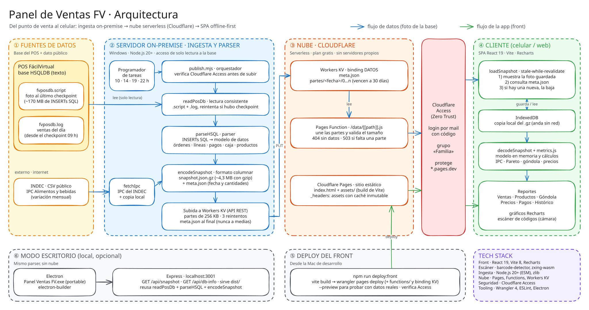

# Panel Ventas FV

Panel de reportes de ventas para un supermercado con POS FácilVirtual. Los datos salen de la base del POS, se procesan en el servidor local del negocio y se publican en Cloudflare para verlos desde el celular, sin elegir ningún archivo.

## Arquitectura



| Capa | Qué hace | Código |
|---|---|---|
| ① Fuentes de datos | Base HSQLDB del POS (`fvposdb.script` + `fvposdb.log`) y el IPC del INDEC | — |
| ② Servidor on-premise · ingesta y parser | Lee la base (solo lectura), la parsea, arma la foto compacta y la sube a Workers KV. Lo dispara el Programador de tareas a las 10, 14, 19 y 22 h | `scripts/publish.mjs`, `scripts/export-snapshot.mjs`, `server/src/readPosDb.mjs`, `src/lib/parseHSQL.js`, `src/lib/snapshot.js` |
| ③ Nube · Cloudflare | Workers KV guarda la foto en partes; una Pages Function la sirve en `/data/*`; Pages sirve el front | `functions/data/[[path]].js`, `wrangler.json` |
| Cloudflare Access | Protege todo el sitio: login por mail con código, solo para el grupo autorizado | panel de Zero Trust |
| ④ Cliente | SPA que muestra al instante la última foto guardada en IndexedDB y busca una nueva | `src/lib/loadSnapshot.js`, `src/lib/metrics.js`, `src/pages/` |
| ⑤ Deploy del front | Build de Vite y `wrangler pages deploy`, independiente de los datos | `scripts/deploy-front.mjs` |
| ⑥ Modo escritorio | Electron + Express en `localhost:3001`, con el mismo parser y sin nube | `electron/main.cjs`, `server/src/server.cjs` |

> El diagrama es un SVG de Excalidraw con la escena embebida: para editarlo, abrir [excalidraw.com](https://excalidraw.com) y arrastrar `docs/arquitectura.excalidraw.svg` (o *Open*). Exportarlo de nuevo como SVG con **Embed scene** tildado y fondo blanco, y reemplazar el archivo.

## Tecnologías

| | |
|---|---|
| Front | React 19, Vite 8, Recharts, barcode-detector (zxing-wasm) |
| Ingesta | Node.js 20+ (ESM), zlib |
| Nube | Cloudflare Pages, Pages Functions, Workers KV |
| Seguridad | Cloudflare Access (Zero Trust) |
| Escritorio | Electron, electron-builder, Express |
| Tooling | Wrangler 4, ESLint |

## Estructura del proyecto

```text
ventas-dashboard-jsx/
├── electron/
│   └── main.cjs
│
├── server/
│   └── src/
│       └── server.cjs
│
├── src/
│   └── Frontend React
│
├── public/
├── dist/
├── package.json
└── vite.config.js
```

## Requisitos

* Node.js 20 o superior
* npm

## Instalación

```bash
npm install
```

## Desarrollo

### Iniciar frontend y backend

```bash
npm run start
```

Este comando inicia:

* Vite (Frontend React)
* Express (Backend)

### Solo frontend

```bash
npm run dev
```

### Solo backend

```bash
npm run server
```

### Ejecutar Electron

```bash
npm run electron
```

Electron inicia automáticamente el servidor Express y abre la aplicación de escritorio.

## Build de producción

Generar el frontend compilado:

```bash
npm run build
```

El resultado se almacena en:

```text
dist/
```

## Endpoints

### Información de la base de datos

```http
GET /api/db-info
```

Respuesta:

```json
{
  "found": true,
  "path": "...",
  "size": 12345,
  "modified": "2026-06-02T12:34:56.000Z",
  "log": { "size": 222496, "modified": "2026-06-02T12:34:56.000Z" }
}
```

`modified` es la escritura más nueva entre `fvposdb.script` y `fvposdb.log`. `log` es `null` si no hay `.log`.

### Foto de la base de datos

```http
GET /api/snapshot
```

Lee `fvposdb.script` y el `fvposdb.log` que está al lado (las ventas desde el último checkpoint), y devuelve la foto en el mismo formato que la publicada (`snapshot.json.gz`, ver `src/lib/snapshot.js`). La variable `FV_DB_PATH` cambia la ruta de la base.

## Ubicación del archivo de datos

### Windows

```text
C:\FacilVirtual\data\fvposdb.script
```

### macOS / Linux

```text
~/Downloads/fvposdb.script
```

## Generación de ejecutable portable

### Compilar frontend

```bash
npm run build
```

### Generar ejecutable

```bash
npm run dist
```

El ejecutable se genera en:

```text
release/
```

Ejemplo:

```text
release/
└── Panel Ventas FV.exe
```

## Distribución

El ejecutable portable:

* No requiere instalación.
* No requiere Node.js.
* No requiere abrir navegador.
* Inicia automáticamente el servidor interno.
* Lee el archivo `fvposdb.script` desde la ubicación configurada.

## Scripts disponibles

```bash
npm run dev
npm run server
npm run start
npm run build
npm run preview
npm run electron
npm run dist
npm run lint
```
